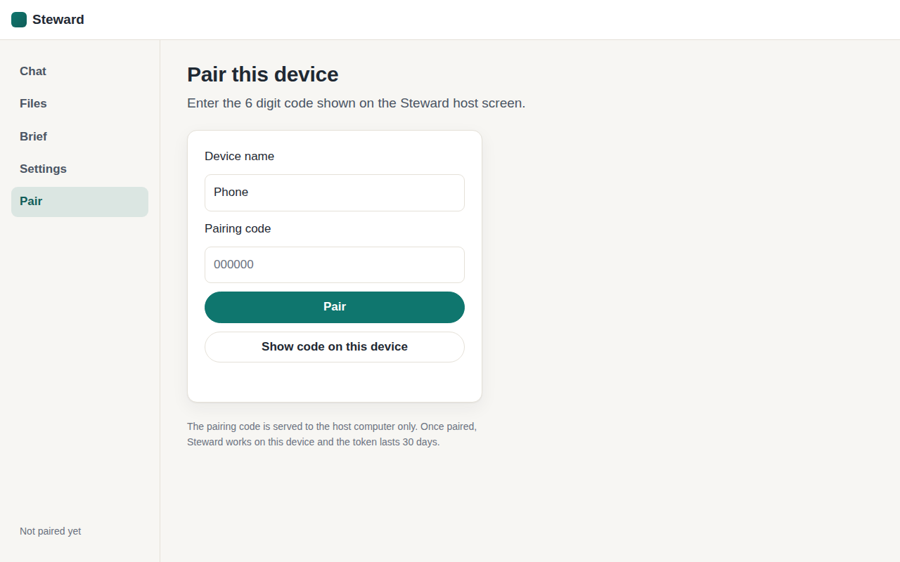
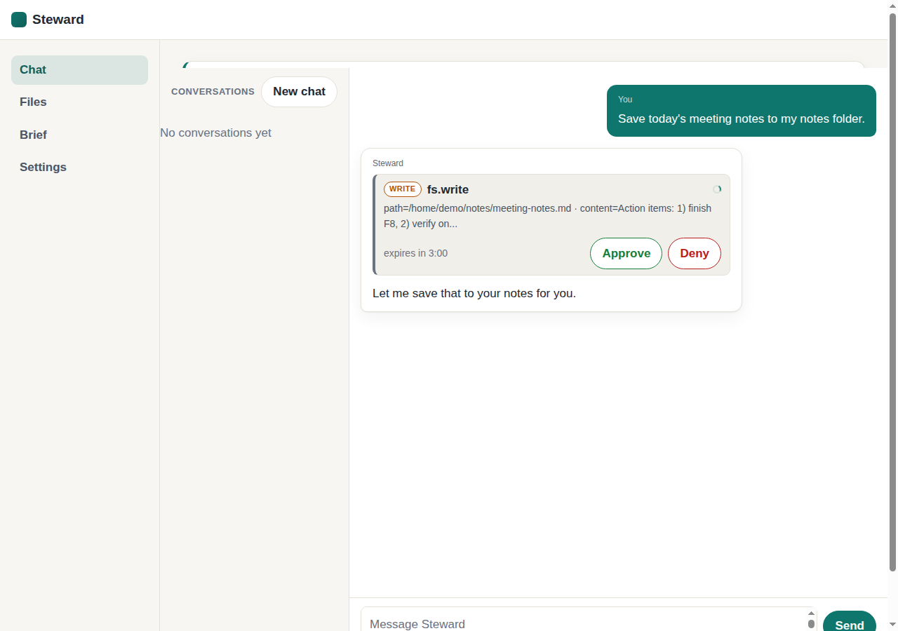

<p align="center">
  
</p>
<p align="center"><em>The personal AI you own, on hardware you already have.</em></p>

Steward turns a computer you already own into an always-on personal AI
assistant. Install it on your machine and it measures what that machine can
actually run, picks the right open models, serves them from a local backend,
and answers from your own files, calendar and notes. You reach it from a web
app in the browser and a paired phone app. There is no account and nothing
leaves the machine it runs on.

It is for people who want an AI assistant that is not a cloud subscription:
home-lab owners, privacy-sensitive users, and anyone with a computer that has
16 GB or more of usable memory and an hour for a first setup. You do not
consult a vendor's list of approved hardware. The setup wizard checks your
machine and tells you plainly what it will run.

## Quickstart (Linux arm64)

The current release is 1.3.0. Today there are real binaries for Linux on
arm64 only: a single-file executable and a Debian package. Windows, macOS and
amd64 are not built yet, and the documentation says so instead of pretending
otherwise. See [docs/BUILD-MATRIX.md](docs/BUILD-MATRIX.md) for the honest
build state.

**Debian and Ubuntu**

```bash
# 1. Download the app package attached to the latest release of this
#    repository, then install it and start the user service.
sudo apt install ./steward_1.3.0_arm64.deb
systemctl --user enable --now steward

# 2. Run the setup wizard. It measures your machine, downloads a model if
#    needed, starts the backend, runs a self-test, and resumes if interrupted.
steward setup

# 3. Open the web app and type your first question. The reply streams in
#    as it is generated.
#    -> http://localhost:3877
```

Each release also publishes a one-file binary plus an install script that
verifies the sha256 checksum and installs to `~/.local/bin/steward`. Build
from source with `make build-linux` or `make build-deb`.

**Pair your phone (optional).** Open Settings in the web app, choose Pair,
and enter the 6 digit code shown on the host. The same conversation then
appears on your phone. Ten numbered steps with what each screen should
show are in [docs/QUICKSTART.md](docs/QUICKSTART.md).

`steward check` prints what a machine can run without running setup.
`steward doctor` reports hardware, backend mode, model and data directory,
and `steward doctor --bundle` writes a redacted support archive you can share.

## What it looks like

Real captures of the daemon-served web client.

| | |
| --- | --- |
|  |  |
| **Chat on the desktop.** The conversation list on the left; the assistant's reply streams in on the right. | **Pairing.** The 6 digit code is shown on the host machine only. |
|  |  |
| **Settings on the phone.** Telemetry shows off, permanently; there is no code path to turn it on. | **Approvals.** A write, execute or network step pauses until you approve it, with a live countdown. |

## The privacy promise, stated concretely

- Your conversations, extracted facts, the local index built from your
  folders, settings and logs all live under one folder on your machine,
  `~/.steward` by default (move it with `STEWARD_HOME`). The folder and every
  subdirectory are created owner-only, mode 0700.
- There is no account and no telemetry. The web client makes zero external
  requests: no fonts, no scripts, no tracking pixels from anywhere.
- The phone app talks only to the host you pair it with, over your local
  network, using a session token scoped to that pairing.
- The complete list of outbound calls is two, and both happen only when you
  let them: downloading a model the first time, and a signed update check so
  the app can tell you a new version exists. Nothing else ever leaves the
  machine.
- Deleting everything is `rm -rf ~/.steward` (or your `STEWARD_HOME`). The
  full statement, including what is and is not encrypted in this version, is
  in [docs/PRIVACY.md](docs/PRIVACY.md).

## How updates work

Steward checks for updates itself. `steward update check` asks the release
source and reports what is new; `steward update apply` downloads a
SHA-256-verified payload, runs a health check, and rolls back to the previous
binary if the new one does not answer. The daemon runs the same check at
start and when you ask, and it never fails to start because the update source
is unreachable. Updates are signed with the same key as licenses, so a
tampered manifest or payload is refused before it is installed. The web app
and the phone app also check when you open them: a notice shows the new
version, and one click downloads, verifies, applies and restarts the daemon,
which comes back to the same conversation. Version history is in
[docs/CHANGELOG.md](docs/CHANGELOG.md).

## Tools and approvals

Steward can act in a turn, not just talk: read and write files, read your
calendar, run a shell command, or fetch a URL. Reading is free. Anything that
writes, executes or reaches the network pauses the turn until you approve it.
The prompt shows the tool, the risk, its arguments and a live countdown, and
a prompt that lapses just reads "expired, ask again". A denied or failed step
is described in plain language, never dumped as JSON. Every approval decision
is logged by the daemon, and there is no toggle to turn the gate off. The
workflow is shown in the screenshots above.

## Getting help and contributing

- Report a bug or request a feature through the issue templates in this
  repository. A report is diagnosable in minutes when it includes the output
  of `steward doctor --bundle` (see
  [.github/ISSUE_TEMPLATE/bug_report.yml](.github/ISSUE_TEMPLATE/bug_report.yml)).
- Security reports go through the private route in [SECURITY.md](SECURITY.md),
  never a public issue.
- This project is maintained by one person. Issues are read as they come in,
  but a reply or a fix can take days, and the maintainer will say so when a
  fix lands. Good-first-issue candidates are listed, with acceptance
  criteria, in [docs/GOOD-FIRST-ISSUES.md](docs/GOOD-FIRST-ISSUES.md).
- Contributing (DCO, no CLA, how to run the tests) is in
  [CONTRIBUTING.md](CONTRIBUTING.md). All participants follow
  [CODE_OF_CONDUCT.md](CODE_OF_CONDUCT.md).

## Repository layout

```
assets/brand/    logo and icon set (SVG and PNG)
docs/            quickstart, privacy, compatibility, changelog, roadmap
src/steward/     the product source
apps/mobile/     iOS and Android app (Expo)
site/            self-hosted landing page
packaging/       binary, deb, and store manifests
```

## License

MIT. The product business model is separate from this repository's license;
the source in this repository is MIT regardless.
