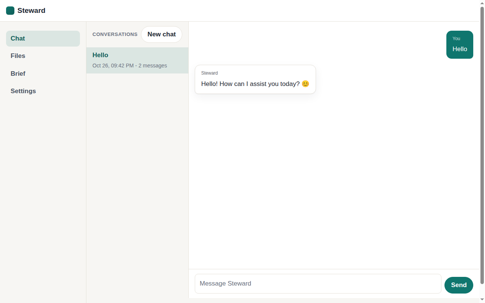
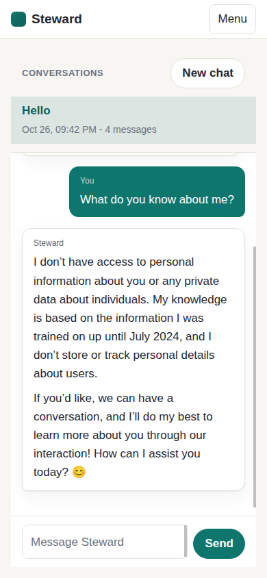
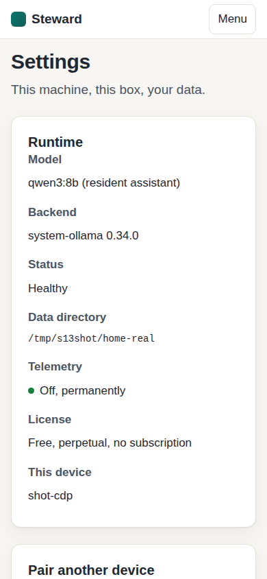
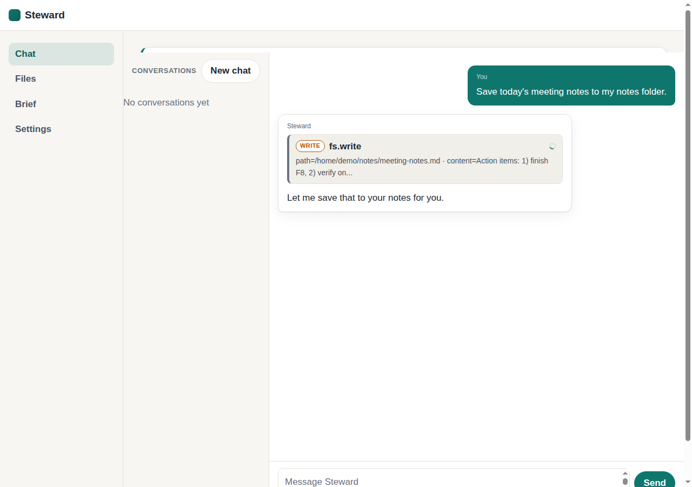
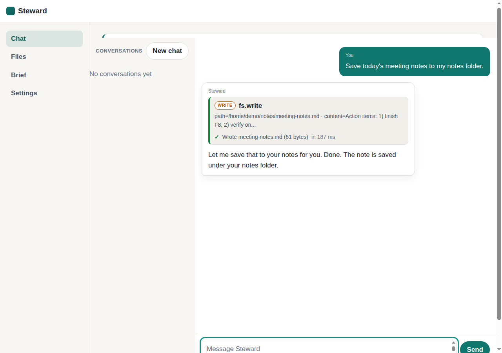
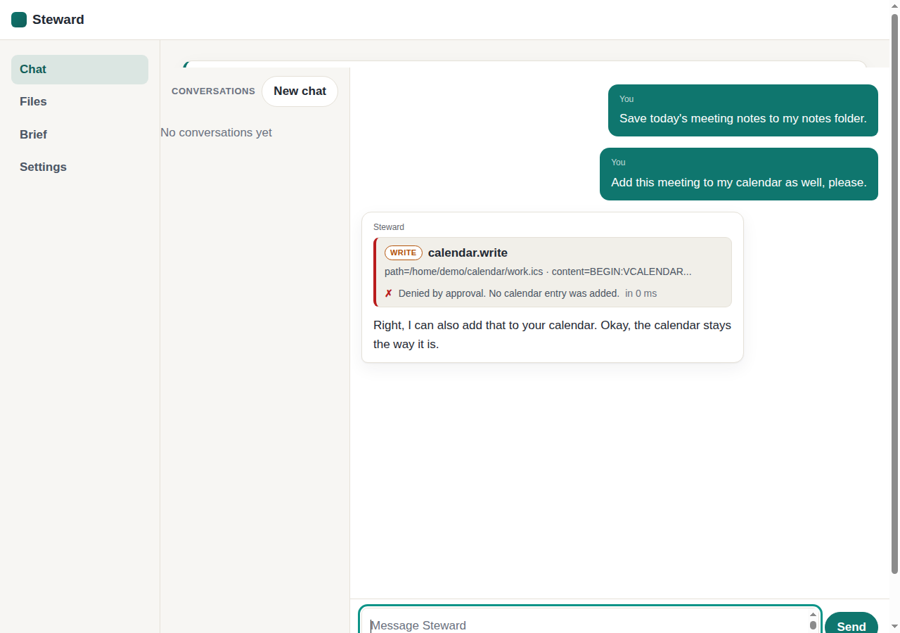
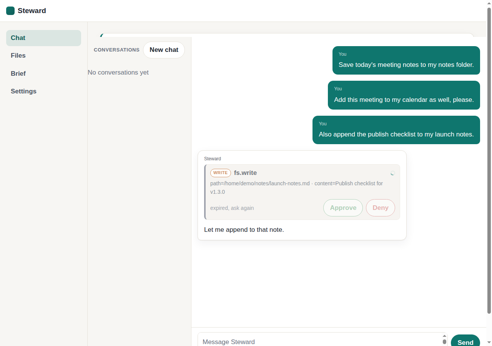

# Steward

The personal AI you own, served on hardware you already have.

Steward is a software product, not a box. Install it on a computer you
already own, and it detects the machine, computes what it can run,
auto-selects and serves the right open models through a local backend, and
answers from your own files, calendar and notes. It is an always-on
assistant reachable from a web app in the browser and a phone app. Install
to first answer is a guided wizard; the free tier lets you use it as long
as you want; a one-time perpetual license unlocks the full feature tiers
and never renews. Everything it knows stays on the machine it runs on.

Steward exists because the same software experience that ships in a $3,499
one-use computer is available on hardware people already own. Steward is
the anti-Ghost: the same ownership story, no hardware markup, honest about
what memory each model really needs.

## The short story

- **Free to install and use.** The assistant works out of the box. The
  free tier includes install, the base assistant, one device, phone and
  web access, basic memory, and base over-the-air updates.
- **Perpetual license, not a subscription.** A one-time license (Personal
  $79, Home $149, Power $249) unlocks the capability tiers and keeps
  working forever, offline, with no renewal. Optional add-on feature packs
  are the only thing that can cost extra, and nothing you buy is ever
  gated behind them.
- **Nothing leaves the box.** Your chats, files, extracted facts and
  settings live in one folder on your own machine. There is no account, no
  telemetry, and no phone-home. The only outbound calls are the initial
  model download and signed update checks. See docs/PRIVACY.md.
- **Runs on what you have.** Compatibility is computed from your machine,
  not a vendor list. The floor is 16 GB of usable memory; 40 GB unlocks the
  full experience. `steward check` tells any machine what it gets. See
  docs/COMPATIBILITY.md.

## Install

Steward installs as a single self-contained binary. No Python, no runtime,
and no models are bundled with the package; models are served by the local
backend.

**Linux (Debian and Ubuntu)**

```
# Debian and Ubuntu: the package name carries the architecture, and only the
# architecture you built is published. Check what the release actually has:
curl -fsSL -H "Authorization: token $STEWARD_GITEA_TOKEN" \
  https://github.com/api/v1/repos/don/steward/releases/latest \
  | grep -o 'steward_[^"]*\.deb'
sudo apt install ./steward_1.0.0_<arch>.deb     # arm64 today; amd64 needs an amd64 build host
systemctl --user enable --now steward
```

Or the curl one-liner, which fetches the release asset matching your
architecture, verifies its sha256 checksum, and installs to
`~/.local/bin/steward`:

```
sh -c "$(curl -fsSL <install-script-url>)"
```

Build from source with `make build-linux` (one-file binary at
`dist/steward`) or `make build-deb` (the `.deb`).

**Windows and macOS**

Template manifests exist for winget and Homebrew, and the intended
one-liners are `winget install Steward` and `brew install steward`. No
Windows or macOS binary is built for this release, so those manifests
carry placeholder checksums and are NOT MEASURED. The Linux artifacts are
the only real builds.

## 60-second quickstart

1. Install (steps above).
2. Run `steward setup`. The wizard detects your hardware, shows the
   verdict for your machine, downloads the model if needed, starts the
   backend, and runs a self-test. It resumes if interrupted.
3. Open the web app at `http://localhost:3877` and type your first
   question. The reply streams in as it is generated.
4. Pair your phone with the 6 digit code on the host, and the same
   conversation appears there.

Ten numbered steps with what every screen should show are in
docs/QUICKSTART.md.

## Updating Steward

Steward checks for updates itself: `steward update check` asks the released
update source (or `STEWARD_OTA_URL`) and reports what is new; `steward
update apply` downloads a verified payload, runs the installed version's
health check, and rolls back to the previous binary if the new one does not
answer. The daemon runs the same check once at start and on request
(`GET /v1/update/check`, `POST /v1/update/apply`) and never fails to start
when the source is unreachable. Updates are signed with the same vendor key
as licenses, so a tampered manifest or payload is refused before anything
is installed. The release flow publishes the signed manifest with
`tools/mint_manifest.py`.

The web app and the phone app also check when you open them: a notice shows
the new version and notes, and one click downloads, verifies, applies and
restarts the daemon, which comes back to the same conversation. Auto-check
on/off and a manual "Check for updates" live in Settings on both clients.
Screenshots of the notice, the progress bar and the post-restart reconnect
are in `docs/images/s15-*`; `tools/e2e_update.py` proves the old-to-new
upgrade end to end.

## Tools and approvals

Steward can take action in a chat turn instead of only talking: reading and
writing files, reading your calendar, running a shell command, or fetching a
URL. Every step renders inline in the same turn with the tool, its risk, and
a one-line summary, a spinner while it runs, and a plain ok or failed line
when it settles. Reading is free. Anything that writes, executes or reaches
the network pauses the turn until you approve it: the Approve / Deny prompt
shows the tool, the risk, and a live countdown, and a prompt that lapses just
reads "expired, ask again". A denied or failed step is described in plain
language, never dumped as JSON. Every approval decision is logged by the
daemon. The web client and the phone behave the same, and there is no toggle
to turn off.

## What it does with your data

Everything is stored under one data root, `~/.steward` by default
(move it with `STEWARD_HOME`): your conversations and messages, the facts
and briefs Steward extracts, the local index it builds from your folders,
the model files, your license entitlement, and logs. The folder and its
subdirectories are owner-only.

Nothing is sent anywhere: no chat content, no files, no memory, no
telemetry. The web client makes zero external requests, the phone app
talks only to your host, and there is no account. The complete list of
what is stored, what is never sent, and how to delete it all is in
docs/PRIVACY.md.

## Screenshots

Real captures of the daemon-served web client, backends wired to a live
Ollama instance.







### Tools in chat










## Repo layout

```
README.md            this file
docs/
  QUICKSTART.md      ten steps to a first answer
  PRIVACY.md         what is stored, what is never sent, how to delete
  COMPATIBILITY.md   verdict states, thresholds, tested examples
  CHANGELOG.md       release history
  PRD.md             product requirements
  ARCHITECTURE.md    how it is built
  ROADMAP.md         milestones
  PRICING.md         licensing model
site/                self-hosted landing page
src/steward/         the product source
apps/mobile/         iOS and Android app (Expo)
packaging/           binary, deb, and store manifests
```

## Docs and source of truth

- Gitea repo: `don/steward` is the source of truth, at
  `https://github.com/dmltallen/steward`.
- Release history and measured numbers: docs/CHANGELOG.md.

## License

MIT (open core; the product business model is separate from the repo
license).
